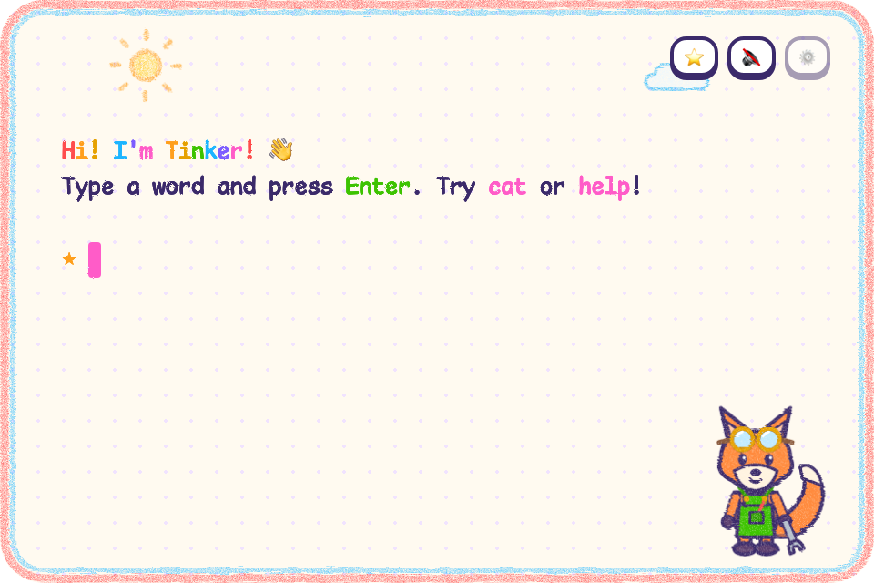

# TinkerTerm

A first terminal for kids aged 3 to 14. Thick crayon lines, a friendly mascot, sounds, and answers read aloud
by a voice that runs entirely on your computer. Pick a look that fits the kid: nine themes from wax crayons to a
pro dev terminal.



Built on [xterm.js](https://xtermjs.org), [Tauri v2](https://tauri.app) and
[portable-pty](https://crates.io/crates/portable-pty). macOS is the tested platform.

## Run

You need [Node 20+](https://nodejs.org), [pnpm](https://pnpm.io) and [Rust](https://rustup.rs).

```sh
pnpm install
node scripts/fetch-voice.mjs    # one-time, ~322 MB voice model (also runs before pnpm dev / pnpm build)
pnpm tauri dev                  # the app
pnpm dev                        # browser preview at http://localhost:1420 (kid mode only, system voice)
```

Without the model the app still works and speaks with the system voice. This is a source-only release: build
it yourself with `pnpm tauri build`.

## Themes

Type `theme` in the toy shell, or pick one under the grown-up corner's Look setting.

| Theme | Ages | What it is |
| --- | --- | --- |
| Crayon Box | 2-5 | wax crayons, sunny sky, and Tinker the fox (or another buddy) |
| Toy Workshop | 4-7 | gears, buttons, beads, and Bolt the wind-up robot |
| Paint Studio | 5-9 | a goofy paint program with stamps, spray cans and dynamite |
| Block World | 6-9 | build in a pixel world, fill your hotbar with Bloop |
| Brick Manual | 6-9 | a building-instruction booklet: every command is a build step |
| Deep Sea Lab | 8-12 | pilot a research sub to the bottom of the sea with Dr. Squiggs |
| Mission Control | 9-13 | flight console, live telemetry, CAPCOM on the radio |
| Retro Arcade | 9-14 | neon cabinet, high scores, and Blip the pixel bot |
| Pro Studio | 11+ | a sleek dev terminal, like the pros use |

### Buddies

Crayon Box comes with five buddies; pick one under the grown-up corner's Buddy setting. Each has its own pose
for every mood (idle, happy, thinking, dancing, waving, wow, asleep).

| Buddy | Who they are |
| --- | --- |
| Tinker | a fox kit in overalls and too-big goggles who fixes things (the default, and the app icon) |
| Sprocket | a wind-up tin robot whose face is a tiny terminal screen |
| Stubby | the shortest crayon in the box, leaving a scribble wherever it goes |
| Shelly | a hermit crab with a sticker-covered shell |
| Sniffles | a baby dragon, still in half an eggshell, who sneezes letters instead of fire |

Each theme has its own font, colors, sounds, wording and sidekick. A theme is one folder in `src/themes/`; see
`src/theme-api.ts` for what it can define.

## Kid mode (default)

A pretend shell: no files, no processes, nothing to break. Type `help` to see everything. Animal and object words
(`cat`, `rocket`, `dino`) show a picture and make a noise; `say hello` shows the word in giant letters and speaks
it; `2 + 3` does math with apples; `count 10`, `color pink`, `name Sam`, `party`, `dance`, `joke`, `roll`, `abc`.
Unknown words never error: the sidekick suggests something to try.

## Voice

Answers are spoken by [Kokoro-82M](https://huggingface.co/hexgrad/Kokoro-82M), run natively in Rust through ONNX
Runtime. Nothing is sent over the network, and there is no pre-recorded audio. The model is downloaded once by
`scripts/fetch-voice.mjs` into `src-tauri/resources/kokoro/` and is not part of this repository. The 🔊 button
mutes sound and voice.

## Stickers

The ⭐ button opens a tray of stickers. Drop them anywhere on the screen, even outside the window. Drag to move,
scroll to resize, double-click to remove. They are remembered between sessions.

## Grown-up corner

The ⚙️ button (or Cmd/Ctrl+,) asks a times-table question, then opens settings: sounds, read-aloud, text size,
crayon-edge text, theme, buddy, font (the theme's own, or Comic Mono, Illinois Mono, or OpenDyslexic Mono
for kids who find letters jumbled), kid's name, and **Open real shell**. The real shell is your login shell started in
`~/TinkerTerm Playground`. It is not a sandbox: it can reach every file you can.

Cmd/Ctrl + = / − / 0 changes the text size.

## License

[MIT](LICENSE). Fonts and the voice model have their own licenses: see [THIRD-PARTY.md](THIRD-PARTY.md).
